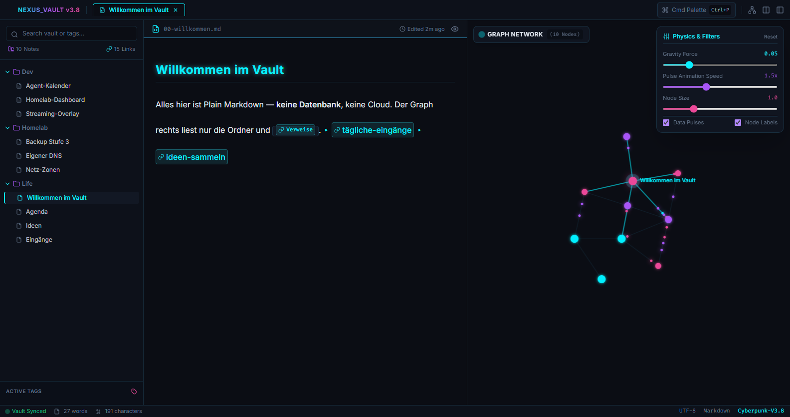

# Cyber Cortex

Das eigene Obsidian-Vault als eigenen Fenster — die Cyberpunk-Mockup-Oberfläche
**1:1**, befüllt mit den echten Notizen, live.



## Warum

Das Vault-Ordner ist das Gedächtnis (Plain Markdown). Die App ist sein Gesicht:
Sie liest die Ordner, baut Knoten + Kanten aus den `[[Wikilinks]]` und zeigt
dasselbe Fenster, das als Mockup entworfen wurde — **eine geänderte Stelle**
(`__VAULT_DATA__` → echtes JSON). Wer Notizen schreibt (Mensch oder Agent),
sieht die App sofort mitziehen.

## Was sie kann

- **Lesen + Suchen:** Dateibaum, Tag-Chips, Suche (springt in die Notiz),
  Graph mit Physik, Klick auf Knoten → Notiz.
- **Bearbeiten (roh):** `Strg+E` öffnet die aktive Notiz als echten
  Markdown-Text, `Strg+S` schreibt die Datei zurück (UTF-8 ohne BOM,
  Zeilenenden bewahrt, nur Pfade im Vault).
- **Live:** `fs.watch` auf dem Vault + ein Silhouetten-Intervall
  (Dateizahl + neueste Änderung) als Sicherheitsnetz — die App baut neu,
  wenn sich etwas im Vault ändert. Ein Schreiben von Claude Code (oder
  jedem anderen Prozess) reicht als Trigger.

## Start

```powershell
npm install
npm start            # Vault: %USERPROFILE%\Obsidian (Vorgabe)
```

Anderer Vault: `$env:CYBER_CORTEX_VAULT = "C:\pfad\zum\vault"` vor dem Start.

**Autostart:** den Aufruf von `start-cortex.vbs` in
`HKCU\Software\Microsoft\Windows\CurrentVersion\Run` eintragen — der
Launcher findet seinen Ordner selbst und öffnet ohne Konsolenfenster.

## Tests

```powershell
npm test             # Selbsttest der Kernlogik (ohne Electron)
```

## Grenzen (bewusst)

- Kein Datenbank/Konto/Cloud — der Ordner ist die Quelle.
- Kein WYSIWYG-Editor; die Bearbeitung ist Roh-Markdown.
- Das Mockup lädt Tailwind per CDN — ohne Internet läuft die Optik roh.
- Eine App-Instanz pro Vault: Die gebaute Ansicht liegt in `.lauf/`
  (nicht committet); **zwei Instanzen auf denselben Ordner überschreiben
  sich gegenseitig** — eine instanz, ein Vault.